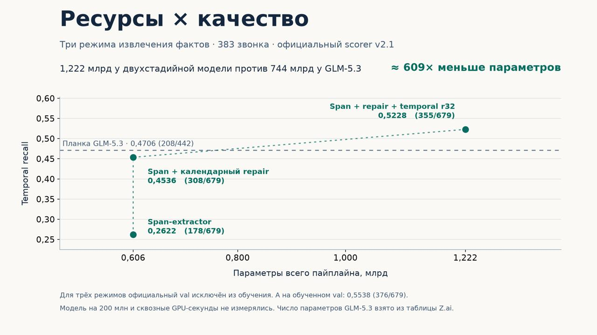

# Ресурсы и качество



## Что подтверждено

- **Экономия параметров.** В официальных материалах кейса baseline назван GLM-5.3. В таблице разработчика Z.ai у GLM-5.3 указано 744 млрд параметров и около 40 млрд активных на токен. Сравниваем полное количество параметров: 744 000 000 000 / 1 222 377 472 = **608,65×**. Связанные эмбеддинги учтены один раз на экземпляр Qwen. Это доказательство по параметрам. Пятикратная экономия GPU-секунд потребовала бы отдельного сквозного измерения на обеих системах. [Таблица моделей Z.ai](https://github.com/zai-org/glm-5/blob/main/README.md#download-model)
- **Качество.** Три измеренных режима на одном official val имеют одинаковый набор из 679 подходящих пар. График показывает экстрактор, экстрактор с календарным repair и исторический r32-контроль, для которого официальный val исключён из обучения temporal-модели. Экстрактор использовал val для выбора чекпойнта. Результат варианта A (376/679, 0,5538) приведён в подписи и относится к виденным данным, поскольку A обучался с включением official val.
- **Размеры.** Модель около 606 млн показана с repair и без него. Точка 1,222 млрд включает две базы и два адаптера. Целевой вариант около 200 млн параметров остаётся без измерения качества.
- **Сквозные измерения.** Сохранённые логи A и D содержат GPU wall-time только temporal-стадии и пик памяти при обучении. CPU 6,62 с на 383 звонках относится к календарной обработке сохранённых ответов. Эти числа нельзя складывать для расчёта p95, throughput или GPU-секунд внедрения.

## Единый протокол для сквозного замера

Используйте одни и те же transcripts в JSONL для каждого режима и устройства. Для теста обобщения выберите независимый набор. Файл может включать только публичные поля звонка, включая `call_id`, `started_at` и `turns`. Веса и окружение для A, span и repair включены или описаны в основном README.

```bash
python -B inference/benchmark.py calls_public.jsonl --device cpu --mode span
python -B inference/benchmark.py calls_public.jsonl --device cpu --mode repair
python -B inference/benchmark.py calls_public.jsonl --device cpu --mode full

CUDA_VISIBLE_DEVICES=0 python -B inference/benchmark.py calls_public.jsonl --device cuda --mode span
CUDA_VISIBLE_DEVICES=0 python -B inference/benchmark.py calls_public.jsonl --device cuda --mode repair
CUDA_VISIBLE_DEVICES=0 python -B inference/benchmark.py calls_public.jsonl --device cuda --mode full
```

Измеряется обработка от передачи валидированного запроса в пайплайн до готовой структуры фактов. Запуск процесса, загрузка моделей и один прогрев идут отдельно. Batch 1, без параллельных запросов. Span-extractor использует greedy, temporal-стадия A использует sampling с параметрами из лога прогона. Метрики — средняя задержка, P95, звонки в час, пиковый RSS, PyTorch allocated/reserved на GPU и wall-секунды полной обработки на 1000 звонков на одной GPU. Для оценки экономии GPU-секунд baseline нужно измерить на своей реальной конфигурации, суммируя время использования всех GPU. Сетевая задержка API не даёт этой величины.
